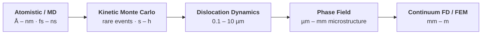

<div align="center">

# Materials Simulation Practicals

**Six hands-on practicals across the length scales of computational materials science —
from atoms to continuum.**

*Foundations of Materials Simulation · Institute of Materials Simulation (WW8) · FAU Erlangen-Nürnberg · WS 2026/27*

[](https://www.python.org/)
[](https://numpy.org/)
[](https://wiki.fysik.dtu.dk/ase/)
[](https://www.ctcms.nist.gov/fipy/)
[](https://www.matsim.techfak.fau.de/)
[](LICENSE)


</div>

---

## About

This repository contains my solutions — simulation code, analysis and reports — for the
**Practicals Materials Simulation** (Kern-/Nebenfachpraktikum), part of the
*Foundations of Materials Simulation* module at the
[Institute of Materials Simulation (WW8)](https://www.matsim.techfak.fau.de/),
Friedrich-Alexander-Universität Erlangen-Nürnberg.

Each practical follows a tutorial script: derive the governing equations, implement or apply
a numerical method, then verify and interpret the results critically. Deliverables per
practical are a **report (~7–15 pages)** with the worked assignments plus the **simulation
code**, discussed with and approved by the supervisor.

## The practicals

| # | Practical | Method & key ideas | Tools | Status |
|:-:|-----------|--------------------|-------|:------:|
| 1 | [**Diffusion & Finite Differences**](Practical%201%20-%20Diffusion%20and%20FD/) | Fick's laws, PDE classification, 2nd-order central differences, Dirichlet/Neumann BCs, sparse linear systems | Python / MATLAB | ⬜ |
| 2 | [**Finite Element Method**](Practical%202%20-%20Finite%20Element%20Method/) | Linear elasticity, weak form, linear shape functions, quadrature, assembly — 1D FE code for a clamped bar | Python / MATLAB | ⬜ |
| 3 | [**Discrete Dislocation Dynamics**](Practical%203%20-%20Discrete%20Dislocation%20Dynamics/) | Peach–Koehler force, Frank–Read source, critical shear stress vs. segment length & character | microMegas + Python wrapper | ⬜ |
| 4 | [**Atomistic Simulation**](Practical%204%20-%20Atomistic%20Simulation/) | Molecular statics (lattice & elastic constants of Cu), MD of carbon nanotubes, ensembles & thermostats | ASE, ASAP3 (EMT, Brenner) | ⬜ |
| 5 | [**Phase Field Method**](Practical%205%20-%20Phase%20Field%20Method/) | Free-energy functional, Allen–Cahn kinetics, finite volumes, 1D solidification, Ni–Al γ/γ′ energetics | Python, FiPy | ⬜ |
| 6 | [**Kinetic Monte Carlo**](Practical%206%20-%20Kinetic%20Monte%20Carlo/) | Residence-time algorithm, thermally activated diffusion, coarse graining, Au in Si via kick-out | Python | ⬜ |

<sub>⬜ not started · 🟨 in progress · ✅ approved. Numbering follows this repo's folders; the official scripts number some practicals differently.</sub>

### Across the scales



## Repository layout

```text
.
├── Practical 1 - Diffusion and FD/
├── Practical 2 - Finite Element Method/
├── Practical 3 - Discrete Dislocation Dynamics/
├── Practical 4 - Atomistic Simulation/
├── Practical 5 - Phase Field Method/
├── Practical 6 - Kinetic Monte Carlo/
├── requirements.txt
└── LICENSE
```

Each practical folder has its own `README.md` with objectives, task list and tools. As work
progresses, each one gets:

```text
Practical N - .../
├── src/        # simulation code
├── figures/    # generated plots
└── report/     # LaTeX source + final report PDF
```

## Getting started

```bash
git clone git@github.com:ali-elite/materials-simulation-practicals.git
cd materials-simulation-practicals
python3 -m venv .venv && source .venv/bin/activate
pip install -r requirements.txt
```

Practical-specific setup:

- **DDD (3):** microMegas is built from the
  [course repository](https://github.com/LAPikachu/practical_DDD) — follow its README.
- **Atomistic (4):** `asap3` compiles a C++ extension; on macOS install via
  `conda install -c conda-forge asap3` if `pip` fails.

Work can be done on any machine or in the WW8 CIP pool (R 2.029, Fürth).

## Course material

Tutorial scripts and literature (FAU WW8 scripts, papers and book chapters) are **not
included**: they are © their respective authors and publishers. Get them from StudOn or the
supervisors and drop them into the matching practical folder — `*.pdf` is git-ignored, so
they stay local. Only the PDFs inside a `report/` folder are tracked.

## Organisation

- **Module:** Foundations of Materials Simulation (Grundmodul) — MuSiM I/II + Practicals
- **Chair:** Prof. Dr. Michael Zaiser, Institute of Materials Simulation (WW8)
- **Practicals coordinator:** Dr. Frank Wendler
- **Deadline:** reports and code due by the end of the semester break; final discussion per
  practical by appointment (in person or Zoom)

## License

Code in this repository is released under the [MIT License](LICENSE). Course scripts,
figures reproduced from them, and cited literature remain the property of their owners.

<div align="center"><sub>Made at FAU Erlangen-Nürnberg · Department of Materials Science & Engineering</sub></div>
